# DevSecOps CI/CD Pipeline: Secure Task Management API with SonarCloud SAST

> **Tugas Praktikum DevSecOps - Pertemuan 5**  
> **Nama Mahasiswa:** [NAMA ANDA DI SINI] <!-- Silakan edit bagian ini -->  
> **NIM:** [NIM ANDA DI SINI] <!-- Silakan edit bagian ini -->  
> **Repository:** `devsecops-p5-[NIM-ANDA]` <!-- Silakan sesuaikan nama repo -->

---

## 1. Nama Aplikasi & Fungsinya

### Nama Aplikasi
**Secure Task Management REST API**

### Fungsi Aplikasi
Aplikasi ini merupakan layanan backend berbasis RESTful API yang dirancang untuk mengelola daftar tugas (*tasks*) secara aman dengan menerapkan prinsip *Security-First* / *Shift-Left Security*.

Fitur utama aplikasi mencakup:
- **API Health Check**: Memantau status kesehatan sistem (`/health`) dan informasi metadata API (`/`).
- **Operasi CRUD Tugas**:
  - `GET /api/tasks` — Mengambil seluruh daftar tugas dengan dukungan filter *status* dan *priority*.
  - `GET /api/tasks/:id` — Mengambil detail tugas berdasarkan ID.
  - `POST /api/tasks` — Menambahkan tugas baru dengan validasi dan sanitasi input.
  - `PUT /api/tasks/:id` — Memperbarui data tugas dengan validasi ketat.
  - `DELETE /api/tasks/:id` — Menghapus tugas berdasarkan ID.
- **Lapisan Keamanan (Security Features)**:
  - *Input Sanitization & Validation*: Mencegah injeksi karakter berbahaya dan membatasi ukuran string input.
  - *Payload Limit*: Membatasi ukuran body request maksimal `10kb` untuk mencegah serangan *Denial of Service* (DoS).
  - *HTTP Security Headers*: Menerapkan header keamanan standar seperti `X-Content-Type-Options: nosniff`, `X-Frame-Options: DENY`, `X-XSS-Protection`, dan menyembunyikan header `X-Powered-By`.
  - *Centralized Error Handling*: Menghindari kebocoran stack trace internal ke respon publik.

---

## 2. Bahasa & Framework yang Digunakan

- **Runtime Environment**: [Node.js](https://nodejs.org/) (v18 / v20 LTS)
- **Web Framework**: [Express.js](https://expressjs.com/) v5
- **Unit & Integration Testing**: [Jest](https://jestjs.io/) v30
- **HTTP Assertion Library**: [Supertest](https://github.com/ladjs/supertest) v7
- **CI/CD Platform**: [GitHub Actions](https://github.com/features/actions) (Runner `ubuntu-latest`)
- **SAST (Static Application Security Testing)**: [SonarCloud / SonarQube](https://sonarcloud.io/) via `SonarSource/sonarqube-scan-action`

### Struktur File Source Code (Minimal 5 File Bermakna)

Proyek ini memiliki struktur modular dengan 6 file source code utama di direktori `src/`:
1. `src/server.js` — Entry point server HTTP dan penanganan graceful shutdown.
2. `src/app.js` — Konfigurasi aplikasi Express, security headers, dan routing.
3. `src/routes/taskRoutes.js` — Definisi routing endpoint REST API untuk resource `/api/tasks`.
4. `src/controllers/taskController.js` — Controller logic yang menangani pemrosesan data dan status response HTTP.
5. `src/models/taskModel.js` — Model data dan abstraksi penyimpanan in-memory.
6. `src/middleware/validator.js` — Middleware validasi dan sanitasi data input request.

---

## 3. Cara Menjalankan Aplikasi

### A. Prasyarat
- Node.js (v18 atau lebih baru)
- npm (Node Package Manager)

### B. Instalasi Dependensi
Jalankan perintah berikut di root direktori proyek:
```bash
npm install
```

### C. Menjalankan Aplikasi di Lingkungan Lokal
Untuk menjalankan server secara lokal:
```bash
npm start
```
Server akan aktif di: `http://localhost:3000`

Uji endpoint root atau health check:
```bash
curl http://localhost:3000/
curl http://localhost:3000/health
```

### D. Menjalankan Pengujian (Testing & Code Coverage)
Untuk menjalankan seluruh unit dan integration test serta menghasilkan laporan coverage (LCOV):
```bash
npm test
```
Laporan coverage akan dibuat otomatis di folder `coverage/lcov.info` yang nantinya dikirimkan ke SonarCloud.

---

## 4. Overview Pipeline CI/CD yang Diimplementasikan

Pipeline CI/CD diimplementasikan menggunakan **GitHub Actions** pada file [`.github/workflows/devsecops.yml`](.github/workflows/devsecops.yml).

### Arsitektur Alur Pipeline

```mermaid
flowchart LR
    A[Push / PR ke 'main'] --> B[Job 1: build]
    B --> C[Setup Node & npm ci]
    C --> D[Dependency Audit SCA]
    D --> E[Jest Test & Coverage]
    E --> F[Upload Artifact coverage/]
    F --> G[Job 2: sast-scan]
    G --> H[Download Artifact coverage/]
    H --> I[SonarCloud SAST Scan]
    I --> J[SonarCloud Dashboard]
```



### Penjelasan Jobs & Steps:

1. **Trigger / Pemicu**:
   - `push` ke branch `main`.
   - `pull_request` ke branch `main`.

2. **Job 1: `build` (Runner: `ubuntu-latest`)**:
   - Mengambil source code (`actions/checkout@v4`).
   - Menyiapkan environment Node.js 20 (`actions/setup-node@v4`) dengan caching dependensi npm.
   - Melakukan instalasi dependensi secara deterministik (`npm ci`).
   - Menjalankan audit keamanan dependensi / SCA (`npm audit --audit-level=moderate`).
   - Menjalankan unit & integration test menggunakan Jest dan menghasilkan laporan code coverage LCOV (`npm test`).
   - Mengunggah file laporan coverage sebagai artifact (`actions/upload-artifact@v4`) agar dapat dikonsumsi oleh job SAST.

3. **Job 2: `sast-scan` (Runner: `ubuntu-latest`, `needs: [build]`)**:
   - Bergantung langsung pada keberhasilan job `build` (`needs: build`).
   - Melakukan checkout repositori lengkap (`fetch-depth: 0`) agar SonarCloud dapat menganalisis riwayat git blame dan kontribusi kode.
   - Mengunduh artifact coverage dari job sebelumnya (`actions/download-artifact@v4`).
   - Menjalankan pemindaian keamanan statis menggunakan **SonarCloud** (`SonarSource/sonarqube-scan-action@v5`) dengan membaca konfigurasi dari `sonar-project.properties`.
   - Mengirimkan metrik keamanan (vulnerabilities, security hotspots, bugs, code smells, dan test coverage) ke dashboard SonarCloud.

---

## 5. Panduan Konfigurasi SonarCloud & GitHub Secrets

Untuk mengaktifkan pemindaian SonarCloud pada repository Anda:

1. **Buat Repository di GitHub**:
   - Buat repo baru bersifat **PUBLIC** dengan nama sesuai format tugas, contoh: `devsecops-p5-[nim-anda]`.
2. **Setup Proyek di SonarCloud**:
   - Login ke [SonarCloud.io](https://sonarcloud.io/) menggunakan akun GitHub Anda.
   - Klik **"+" > Analyze new project**.
   - Pilih organisasi dan repository GitHub yang baru Anda buat.
   - Masuk ke **Administration > Analysis Method**, matikan *Automatic Analysis* dan pilih *GitHub Actions*.
3. **Update `sonar-project.properties`**:
   - Buka file `sonar-project.properties` di repository ini.
   - Ganti `YOUR_SONAR_PROJECT_KEY` dengan Project Key dari SonarCloud.
   - Ganti `YOUR_SONAR_ORGANIZATION_KEY` dengan Organization Key akun SonarCloud Anda.
4. **Tambahkan Secret di GitHub Repository**:
   - Di SonarCloud, buka **My Account > Security** lalu generate token baru (tipe: *User Token*).
   - Buka repository GitHub Anda: **Settings > Secrets and variables > Actions > New repository secret**.
   - Beri nama: `SONAR_TOKEN` dan tempelkan token yang telah di-generate.
5. **Push Code ke GitHub**:
   ```bash
   git add .
   git commit -m "feat: setup node.js app and devsecops pipeline with sonarcloud sast"
   git remote add origin https://github.com/[username-github]/devsecops-p5-[nim-anda].git
   git push -u origin main
   ```
6. Buka tab **Actions** di repository GitHub Anda untuk melihat kedua job (`build` dan `sast-scan`) terpicu dan berjalan hingga selesai!
